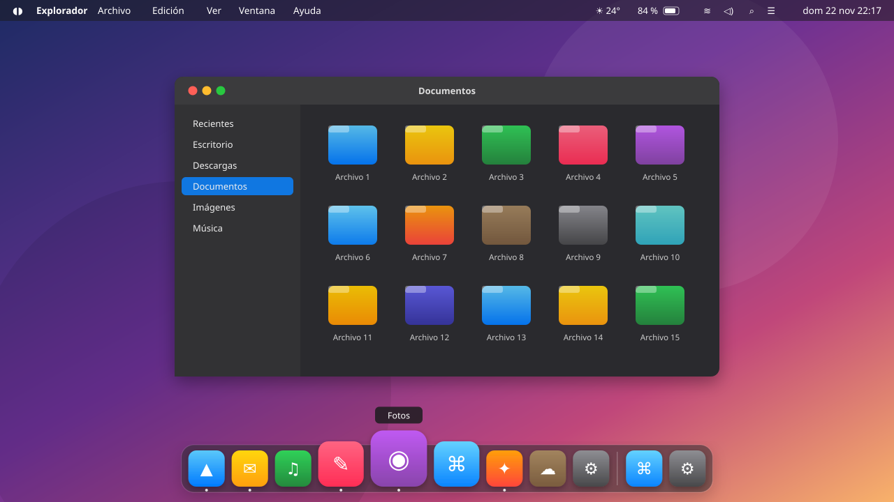
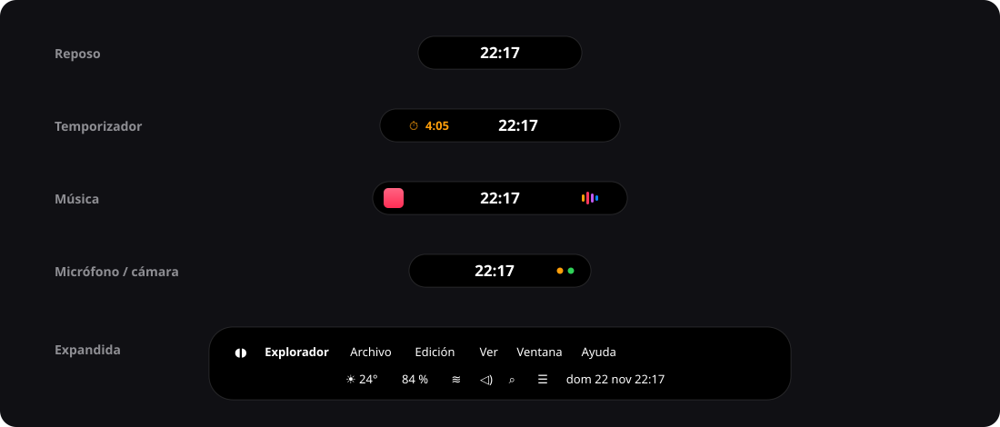
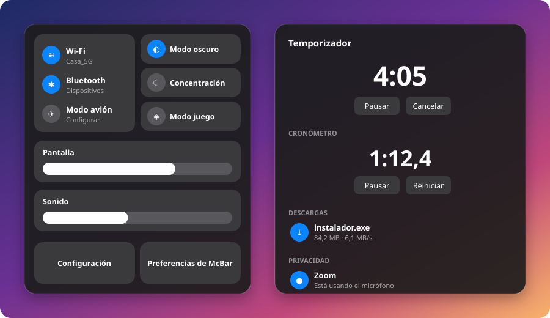
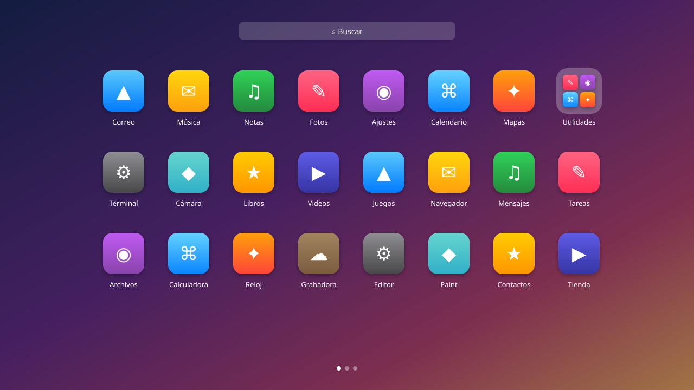
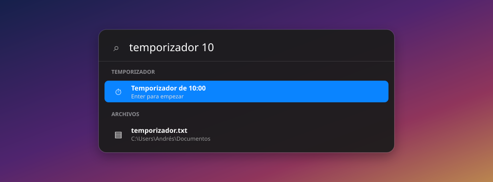
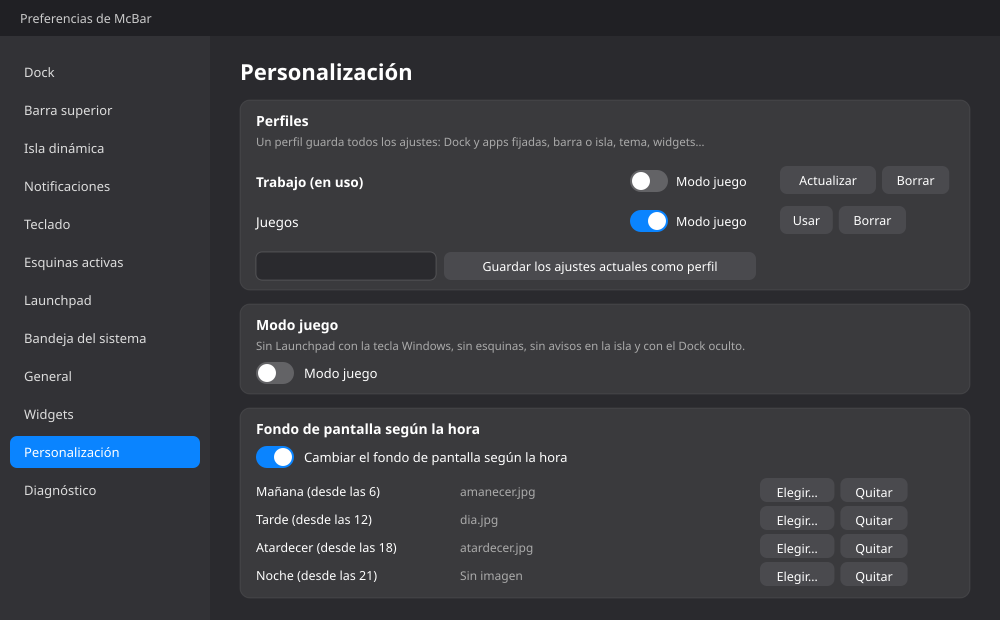

<div align="center">

# McBar

**El Dock, la barra de menú y la isla dinámica de macOS, en Windows 10 y 11.**


Creado por **Andrés Londero**



</div>

McBar reemplaza la barra de tareas de Windows por un **Dock** abajo y una **barra de menú** (o una **isla dinámica**) arriba, con el aspecto y las animaciones de macOS. También trae sus propios Launchpad, buscador, Centro de control, notificaciones, widgets, Wi-Fi/Bluetooth/sonido y Alt+Tab, así que no hace falta abrir nada de Windows. Y gasta lo mínimo: en reposo no usa procesador.

> Las imágenes de esta página son **ilustraciones del diseño** de McBar (los íconos de apps son genéricos). Las capturas reales van en `docs/img/` con los mismos nombres.

---

## Índice

- [Qué trae](#qué-trae)
- [Instalar](#instalar)
- [Atajos de teclado](#atajos-de-teclado)
- [Preferencias](#preferencias)
- [Bajo consumo](#bajo-consumo)
- [Si algo sale mal](#si-algo-sale-mal)
- [Compilar](#compilar)
- [Estructura del proyecto](#estructura-del-proyecto)
- [Historial de versiones](#historial-de-versiones)

---

## Qué trae

### Dock

- Los íconos se agrandan al pasar el mouse (el de abajo del cursor queda fijo y los vecinos se corren, como en macOS). Las apps rebotan al abrirse y las abiertas tienen un puntito.
- Apps fijadas y apps abiertas, **Descargas** (pila con los últimos archivos) y **Papelera** (soltá archivos para borrarlos).
- Se reordena arrastrando. Para sacar un ícono, se arrastra hacia arriba ("Quitar del Dock", con nubecita); si es una app abierta sin fijar, "Cerrar app".
- **Vista previa en vivo** de las ventanas al dejar el mouse sobre un ícono.
- Las ventanas se achican **hacia su ícono** al minimizar.
- **Estilos**: Clásico, Flotante, Ancho completo, Barra (como Windows 11 pero flotante) o Solo íconos.
- **Íconos de macOSicons.com**: McBar lee tus apps instaladas y baja solo el ícono estilo Mac de cada una (con la clave gratis de tu cuenta de macOSicons; los íconos no vienen con McBar y son de sus autores).
- **Íconos con forma de Mac**: todas las apps con el cuadrado de esquinas suaves de macOS (opcional).
- **Paquetes de íconos** de otras barras o sistemas (carpeta con .png / .ico / .jpg / .bmp, buscados por nombre de archivo).
- Ocultación automática y un Dock en cada monitor.

### Barra de menú

- Menú de McBar (Acerca de este equipo, Forzar salida, Suspender, Reiniciar, Apagar, Bloquear, Perfil, Modo juego…).
- La app activa con sus menús **Archivo, Edición, Ver, Ventana y Ayuda**. Ventana incluye **Mover y cambiar tamaño** (mitades, cuartos, tercios). Si no hay ninguna app elegida, los menús se esconden, como en GNOME.
- A la derecha: **bandeja propia** (WhatsApp, antivirus, etc. con sus menús), clima, batería, Wi-Fi, volumen, buscador, Centro de control y reloj.

### Isla dinámica



Es una alternativa a la barra de menú: una píldora negra arriba al centro, como en el iPhone.

- En reposo muestra la hora. Al pasar el mouse se agranda con todo lo de la barra.
- Se agranda sola un momento con el volumen y el brillo, la carga de la batería, un tema nuevo y las notificaciones.
- **Música** (Spotify, YouTube…): tapa del disco y ecualizador; tocándola aparece el reproductor con controles.
- **Actividades en vivo**: temporizador, cronómetro y descargas en curso.
- **Privacidad**: puntito naranja si una app usa el micrófono y verde si usa la cámara (pasando el mouse dice cuál).
- Cada ícono abre su cajón: Wi-Fi, Bluetooth, sonido, batería, clima, notificaciones y Centro de control.
- Se esconde con los videos y juegos en pantalla completa.

### Centro de control, temporizador y conexiones



- **Centro de control**: Wi-Fi, Bluetooth, modo avión, modo oscuro (cambia Windows de verdad), concentración, **modo juego**, brillo y sonido.
- **Wi-Fi, Bluetooth y sonido propios**: conectarse a redes (con contraseña), conectar auriculares Bluetooth con un clic y elegir parlantes, auriculares o micrófono, sin abrir Configuración.
- **Temporizador y cronómetro**: atajos de 1, 5, 10 y 25 minutos, pausa, aviso con sonido. Ahí también se ven las descargas (tamaño y velocidad) y qué app usa el micrófono o la cámara.

### Launchpad



- Todas las apps instaladas (de escritorio y de la Store) en páginas, con búsqueda y fondo desenfocado (transparencia regulable).
- **Carpetas**: soltá una app sobre otra. Las apps y las carpetas se reordenan arrastrándolas al borde.
- Ctrl+clic para elegir varias y **ocultarlas** juntas (al buscar aparecen igual).
- Clic derecho: Agregar al Dock, Ocultar, **Desinstalar**. Arrastrando una app hacia abajo se suelta en el Dock o en el escritorio.

### Buscador (tipo Spotlight)



- Apps, archivos, páginas de Configuración, cuentas ("12*3+4") y búsqueda en la web.
- Comandos: `temporizador 10`, `timer 1:30`, `cronómetro`, `modo juego` o el nombre de un perfil.

### Notificaciones y widgets

- **Centro de notificaciones propio**: junta los avisos de Windows agrupados por app. Opcionalmente oculta el cartelito de Windows.
- **Widgets** (tocando el reloj y también **en el escritorio**): reloj, calendario, clima (Open-Meteo, sin clave), recordatorios, notas, batería y sistema.
- **Calendario de Google / Outlook** con el enlace iCal, sin iniciar sesión, y aviso 10 minutos antes de cada evento.
- **Recordatorios en lenguaje natural**: "comprar pan mañana 18:00", "llamar a Juan en 20 min".
- **Clima** completo: ahora, sensación, humedad, viento, 24 horas y 7 días.

### Ventanas estilo Mac

- **Alt+Tab** como Cmd+Tab: los íconos de las apps abiertas, con la más reciente primero.
- **Win+Tab** como Mission Control: todas las ventanas con miniaturas en vivo y una franja con los escritorios virtuales.
- **Quick Look**: elegí un archivo en el Explorador y apretá **Espacio** para ver la vista previa (fotos, videos, PDF, texto, carpetas).
- **Esquinas activas**: a cada esquina de la pantalla se le asigna Launchpad, Todas las ventanas, Escritorio, Buscador, Notificaciones, Centro de control o Bloquear.

### Personalización



- **Perfiles** ("Trabajo", "Juegos"…): cada uno guarda todos los ajustes (Dock, apps fijadas, barra o isla, tema, widgets). Se cambian desde el menú de McBar, Preferencias o el buscador.
- **Modo juego**: la tecla Windows no abre nada, las esquinas no actúan, los avisos no salen en la isla y el Dock se oculta. Un perfil lo puede prender solo.
- **Fondo de pantalla según la hora**: una imagen para la mañana, la tarde, el atardecer y la noche.
- **Exportar e importar** todos los ajustes en un .json.
- Temas **Claro, Oscuro, Automático y Vidrio**.

---

## Instalar

1. Descargá `McBar.exe` (no hace falta instalar .NET).
2. Abrilo: aparece el **instalador estilo Mac**. Ahí elegís:
   - iniciar con Windows;
   - accesos directos en el menú Inicio y en el escritorio;
   - traer las apps fijadas de la barra de Windows;
   - usar el tema Vidrio.
3. Listo: la barra de Windows se oculta y aparecen el Dock y la barra de menú.

- Se instala **para tu usuario, sin permisos de administrador**, en `%LocalAppData%\Programs\McBar`, y figura en *Configuración → Aplicaciones instaladas*.
- **Actualizar**: abrí el `McBar.exe` nuevo y elegí "Actualizar". Los ajustes se conservan.
- **Probar sin instalar**: botón del instalador o `McBar.exe --portable`.
- **Desinstalar**: *Configuración → Aplicaciones instaladas → McBar → Desinstalar* (o `McBar.exe --uninstall`). La barra de Windows vuelve como estaba.
- **Salir**: menú de McBar (arriba a la izquierda) → *Salir de McBar*.

---

## Atajos de teclado

| Atajo | Qué hace |
|---|---|
| **Win** (sola) | Abre / cierra el Launchpad |
| **Win + S** | Buscador |
| **Win + N** | Notificaciones y widgets |
| **Win + A** | Centro de control |
| **Alt + Tab** / **Alt + Mayús + Tab** | Cambiar de app (estilo Cmd+Tab) |
| **Win + Tab** | Todas las ventanas y escritorios |
| **Espacio** (en el Explorador) | Quick Look |
| **Ctrl + Alt + ← / → / ↑ / ↓** | Ventana a la mitad izquierda / derecha / arriba / abajo |
| **Ctrl + Alt + U / I / J / K** | Ventana a un cuarto de pantalla |
| **Ctrl + Alt + Enter** / **C** / **Retroceso** | Llenar / Centrar / Volver al tamaño anterior |
| Teclas de volumen | Cartel de volumen de McBar (o la isla) |

Todos se pueden apagar en *Preferencias → Teclado*. Con **AltGr** no se activan los de Ctrl+Alt, así que no molestan para escribir @ o #.

---

## Preferencias

Están ordenadas en pestañas: Dock, Barra superior, Isla dinámica, Notificaciones, Teclado, Esquinas activas, Launchpad, Bandeja del sistema, General, Widgets, Personalización y Diagnóstico. Cada cambio se aplica al instante.

| Archivo | Dónde |
|---|---|
| Ajustes | `%AppData%\McBar\settings.json` |
| Recordatorios / notas | `%AppData%\McBar\recordatorios.json`, `notas.txt` |
| Registro | `%AppData%\McBar\mcbar.log` |
| Informes de errores | `%AppData%\McBar\errores\` |

---

## Bajo consumo

- Nada se repite en un bucle en reposo: las ventanas se detectan por avisos de Windows y el reloj se actualiza una vez por minuto.
- Las animaciones corren solo mientras algo se mueve. El temporizador y las descargas se actualizan una vez por segundo y solo mientras están activos.
- Paneles, Launchpad y Preferencias se crean al abrirse y se destruyen al cerrarse; después se devuelve la memoria al sistema.
- Compilado con ReadyToRun para que arranque rápido. En *Preferencias → Diagnóstico* se ve el consumo en vivo.

---

## Si algo sale mal

- Si McBar se cierra por un error, **Windows lo vuelve a abrir solo**, y el informe queda en `%AppData%\McBar\errores`. Si se cae 3 veces en 10 minutos, no se reabre más.
- Si la barra de Windows quedó oculta: ejecutá `McBar.exe --restaurar`. Devuelve la barra, el espacio de las ventanas y la animación de Windows.

---

## Compilar

El proyecto se compila con **GitHub Actions** (no hace falta tener Visual Studio):

1. La primera vez, subí a mano `.github/workflows/build.yml` (está en el zip).
2. Subí **mc.zip** a la rama `main`.
3. El workflow descomprime el zip, sube los archivos, corre las **pruebas** (xUnit) y compila.
4. Descargá **McBar-win-x64** desde *Actions → la ejecución → Artifacts*.

> Si el workflow cambia, hay que subirlo a mano: GitHub no deja que un workflow se modifique a sí mismo.

Para compilar en tu PC: .NET 8 SDK en Windows y `dotnet publish src/McBar -c Release -r win-x64`.

---

## Estructura del proyecto

```
src/McBar/
  App.xaml.cs      coordina todo (monitores, paneles, atajos, recuperación)
  Core/            lógica sin ventanas: ajustes, perfiles, calendario, temporizador, clima…
  Native/          Win32 / COM: ventanas, teclado, audio, Bluetooth, DWM
  Dock/            el Dock
  MenuBar/         barra de menú e isla dinámica
  Panels/          Launchpad, buscador, Centro de control, Preferencias, widgets…
  Themes/          colores (Claro, Oscuro, Vidrio) y estilos
tests/McBar.Tests/ pruebas automáticas (una clase por etapa)
docs/              arquitectura, etapas, pruebas manuales e imágenes
```

Más detalles:

- [docs/ARQUITECTURA.md](docs/ARQUITECTURA.md): cómo está hecho.
- [docs/ETAPAS.md](docs/ETAPAS.md): qué se hizo en cada versión.
- [docs/PRUEBAS.md](docs/PRUEBAS.md): lista de pruebas manuales.
- [CHANGELOG.md](CHANGELOG.md): todos los cambios.
- [CLAUDE.md](CLAUDE.md): guía para seguir desarrollando.

---

## Historial de versiones

| Versión | Qué trajo |
|---|---|
| **1.6.0** | Gráficos: paneles y menús con vidrio, sombra suave y brillo como macOS, animaciones con resorte |
| **1.5.0** | Rendimiento: nítido con monitores de escalas distintas, Launchpad y paneles más fluidos, medición |
| **1.4.1** | Quitar del Dock arrastrando a cualquier lado, apps del Launchpad al escritorio, estilos que no cambiaban |
| **1.4.0** | Baja solo los íconos estilo Mac de tus apps desde macOSicons.com |
| **1.3.2** | Íconos con forma de Mac |
| **1.3.1** | Se reinicia solo si se traba; el instalador vuelve a aparecer con una versión nueva |
| **1.3.0** | Perfiles, modo juego, exportar/importar ajustes, fondo según la hora |
| **1.2.0** | Temporizador y cronómetro en vivo, micrófono/cámara en uso, descargas |
| **1.1.0** | Widgets en el escritorio, calendario Google/Outlook, recordatorios |
| **1.0.0** | Esquinas activas, mosaico de ventanas, escritorios en Win+Tab, Quick Look |
| **0.9.0** | Recuperación ante errores y diagnóstico de consumo |
| **0.8.0** | Vista previa en el Dock, Alt+Tab estilo Cmd+Tab, Win+Tab estilo Mission Control |
| **0.7.0** | Wi-Fi, Bluetooth y sonido propios |
| **0.6.0** | Launchpad con la tecla Windows, buscador, cartel de volumen |
| **0.5.0** | Instalador estilo Mac |
| **0.4.x** | Notificaciones propias, carpetas en el Launchpad, clima, tema Vidrio, estilos del Dock |

<div align="center">
<sub>McBar no está relacionado con Apple ni con Microsoft. macOS y Windows son marcas de sus dueños.</sub><br>
<sub>Creado por Andrés Londero</sub>
</div>
